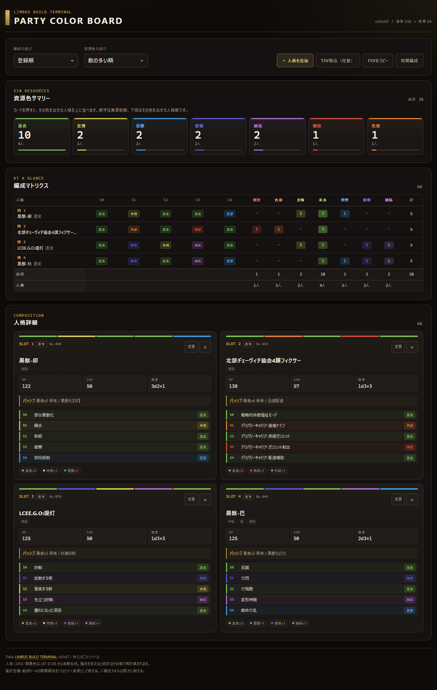

# LIMBUS PARTY COLOR BOARD

LIMBUS BUILD TERMINAL の人格DBを読み込み、編成の罪悪属性（資源色）をスキル単位で自動集計する非公式ツールです。ビルド済みの静的サイトなので、GitHub Pages でそのまま動きます。

**公開URL:** https://lbtstudio.github.io/limbus-party-color-board/



## できること

- 開始時は空の編成。1編成最大20人まで追加でき、人格DB（通常145 + 特異54）から人格を検索して編成に追加・変更・削除
- 各人格の戦術0〜4のスキル色を自動反映。二属性スキルは両方の色に1ずつ数える
- 資源色を「多い順」「出せる人数順」「色順」などで並べ替え
- 資源色カードを押すと、その色を出せる人格を編成の先頭に並べ替え
- 合計値と「その色を出せる人格数」を常時表示
- 公式人格に加え、LBTの同期化・手動編集差分とオリジナル人格を追加して集計
- LBT保存データがなくても、HP/SAN/速度/パッシブ/スキル名・種別・罪悪属性を手動登録
- 編成をURLで共有（公式DB人格キーを使用）
- 共有編成をクラウドに保存し、共有リンクから認証なしで閲覧、必要なら招待・承認なしで編集参加・同期
- 共有編成は30日間未利用で自動終了し、終了から7日後に関連データを自動削除
- TSVコピー、任意のTSV/CSV取り込み（メンバー名・PL名の列は無視）

編成を変えると統計はその場で再計算されます。通常の編成状態はURLとブラウザの `localStorage` に保存されます。共有編成のデータは Supabase のクラウドDBに保存され、利用状況に応じて自動整理されます。

## 同期人格・オリジナル人格を追加する

人格選択ダイアログの **「LBT保存データを読み込む」** を押すと、現在のブラウザ内にある LBT のアカウント保存データを調べ、次の差分を候補として表示します。

- 現在装備中の「同期化して手動編集」状態
- 所持人格に保存した編集ビルド（公式DBとの差分）
- 同期ランク／同期MAXの情報
- 保存済みのオリジナル人格

人格選択画面では、LBTの保存アカウントを選択できます。通常は選択中アカウントの所持人格だけを追加候補に表示し、未所持人格を編成に入れたい場合は **「未所持の人格も表示」** を有効にしてください。同期・創作人格の取り込み対象も、選択中アカウントに限定されます。所持判定にはLBTの所持人格一覧を使います。

取り込みは**読み取り専用のコピー**です。LBT側の保存データを書き換えず、ボード側の追加人格ライブラリに保存します。同じ保存データを再取り込みした場合は重複追加せず更新します。人格選択画面の **「追加人格」** から取り込んだ内容を使い、不要になった追加人格はその一覧から削除できます。

LBT保存データが見つからない場合は **「手動で創作人格を追加」** を使えます。人格名、HP、SAN、速度、所属、キーワード、パッシブ情報、S0〜S4のスキル名・種別・罪悪属性を登録できます。二属性スキルは罪悪属性を2つ選びます。

LBTのセーブデータを直接読めるのは、**同じブラウザプロフィール・同じWebオリジンで開いた場合**です。公開中のLBTとボードは同じ `lbtstudio.github.io` オリジンの別パスにあるため、通常は同じローカル保存領域を参照できます。別ブラウザ、別プロフィール、ローカル開発サーバーなどからは自動検出できないため、その場合は手動登録してください。

### 通信・共有の仕組み

共有編成は「閲覧」と「編集参加」で通信方式を分けています。

- **閲覧モード:** `#session=<セッションID>` の共有リンクを開くだけで編成を確認できます。匿名ログイン・招待申請・参加承認は不要です。初回取得後は自動ポーリングやRealtime接続を行わず、最新状態が必要なときに「編成を更新」を押します。同じタブでは取得結果を最大60秒キャッシュします。
- **編集参加モード:** 「編集に参加」を押すと匿名Authで裏側の参加者レコードを作成し、その場で編集者になります。メール登録や発行者の承認は要求しません。初回認証にTurnstileが設定されている環境では、不正利用防止の確認が必要です。発行者は公開編集を停止でき、その時点で発行者以外の編集参加権限を解除します。
- **同期:** 編集者だけがセッション単位のprivate Realtime Broadcastへ接続します。データベースから送るのはrevision番号だけで、変更が通知された編集者が必要なスナップショットを取得します。Realtimeに接続できない場合は編集画面だけ低頻度ポーリングへフォールバックし、非表示タブでは接続を停止します。
- **競合と保存:** 書き込みは引き続きSupabase RPCでrevision・operation ID・役割を検証します。同時編集時に古い編成を無条件で上書きしません。閲覧中に編集を試みても、画面上の制御だけでなくサーバー側で拒否します。
- **共有するデータ:** 編成に含まれる人格キー、担当PL名、追加人格の必要なスナップショットだけを送信します。LBTのアカウントID、生セーブ全体、装備・履歴データは送信しません。追加人格スナップショットは合計60KB以内です。
- **上限:** 1スペースの編集参加者は発行者を含め20名まで、1ユーザーの同時編集参加も20スペースまでです。閲覧者は編集参加者数に含めません。
- **リンクの扱い:** 共有リンクを知っている人は閲覧できます。公開編集が有効なら、その人は自分で編集参加できます。公開閲覧がOFFなら公開編集もOFFにします。既存スペースは移行直後は非公開・編集参加OFFのまま、新規スペースだけ最初から両方ONです。表示名は本人確認ではありません。
- **個別の参加解除:** 発行者が編集参加者を解除すると、その匿名アカウントは同じスペースへ再参加できません。別のユーザーを誤って解除しないよう、表示名ではなくアカウント識別子で処理します。
- **保存期間:** 30日間誰も共有編成を開かなければ自動で終了扱いになり、さらに7日後に関連データを削除します。発行者が手動終了した場合は即時削除です。

#### 月次無料枠の通信目安

公開閲覧は現在Supabaseの読み取りRPCから取得するため、CDN配信ではありません。閲覧者に定期通信をさせないことでDB要求を抑えていますが、初回・手動更新はDBアクセスと通常Egressを使用します。

追加人格スナップショットの60KBを保守的な1回の取得量として置くと、キャッシュミスの概算は次のとおりです（実際の応答サイズは編成・人格データで変わります）。

| 月間取得回数 | 60KB換算 |
|---:|---:|
| 1,000回 | 約60MB |
| 10,000回 | 約600MB |
| 30,000回 | 約1.8GB |
| 50,000回 | 約3.0GB |

Supabase Freeの通常Egress枠は月5GBです。したがって50,000回の最大サイズ相当取得は、他の通信を含める前に余裕が小さくなります。実際の閲覧スナップショットは60KB未満のことが多いものの、利用量を見ずに大量アクセスへの耐性を保証するものではありません。

Realtimeの通知量はおおむね「編集保存回数 × その時点で接続している編集者数」で増えます。Supabase FreeのRealtime Messages枠は月200万件、同時接続は200です。Presenceや編成データ全体のBroadcastは使わず、revision通知だけに限定します。公開後はSupabase Dashboardで通常Egress、Realtime Messages、Peak Connections、Database Size、DB負荷を監視してください。

閲覧をCDNへ移すには、DB更新と同時に安全なrevision別スナップショットをStorageへ公開する仕組みが別途必要です。現在の実装では整合性を優先し、その仕組みを導入したとは扱いません。

## 複数人での共有について

共有スペースを作成すると、編成ごとの共有リンクが発行されます。リンクを開くと閲覧モードになり、「編集に参加」を押すと編集者として参加します。発行者は公開閲覧・編集参加の有効／無効を切り替え、編集参加者を解除できます。既存のセッション・revision・競合検知・自動整理は維持します。

設定と動作確認の手順は [共有セッション導入手順](docs/shared-sessions-setup.md)、設計は [共有セッション設計](docs/shared-sessions-design.md)、障害・不正利用の想定は [失敗想定と対策](docs/shared-sessions-failure-modes.md) を参照してください。Supabaseの設定が未完了の間も、個人編成モードは利用できます。

## 集計ルール

- 戦術0〜4の各スロットを1資源として数える
- 1スロットに罪悪属性が2つある場合は、両方に1ずつ加算する
- `合計` は資源の総数、`人数` はその色を1つ以上出せる人格の数
- 例: 暴食 `10(4)` は「暴食の資源が合計10、暴食を出せる人格が4人」

スプレッドシートは、ツールの目的を確認するために共有されたサンプルです。実行時の公式データ源は LBT の `data/db.json` で、シートの読み書きは行いません。

## データの更新

`data/personas.json` は `LIMBUS_BUILD_TERMINAL/data/db.json` から生成しています。手で編集せず、DBを更新したら再生成してください。

```sh
npm run build:data
# または
node tools/build-data.mjs --db ../LIMBUS_BUILD_TERMINAL/data/db.json
```

`LBT_DB` 環境変数でDBのパスを指定することもできます。GitHub Actions の `Update persona data` が毎週 LBT のDBを取り込み、差分があれば `data/personas.json` を更新します。

## 開発

Node.js 22 以降を想定しています。集計・取り込みは npm 依存パッケージなしで動きます。共有セッション機能を使う場合は、ブラウザが Supabase JS SDK を ESM CDN から読み込むため、インターネット接続が必要です。

```sh
npm test          # 集計・取り込み・並べ替えのテスト
npm run serve     # http://127.0.0.1:8787/
```

## データ出典

- [LIMBUS BUILD TERMINAL](https://github.com/LBTStudio/LIMBUS_BUILD_TERMINAL) の人格・スキルデータ
- 本ツールは非公式のファンツールです。Project Moon および LBT の公式見解ではありません
