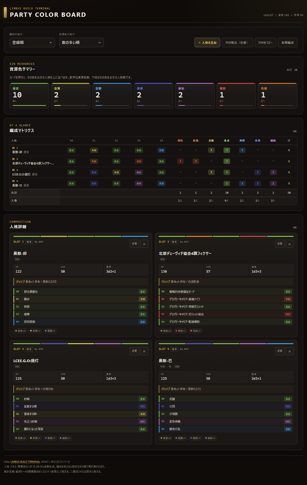

# LIMBUS PARTY COLOR BOARD

LIMBUS BUILD TERMINAL の人格DBを読み込み、編成の罪悪属性（資源色）をスキル単位で自動集計する非公式ツールです。ビルド済みの静的サイトなので、GitHub Pages でそのまま動きます。

**公開URL:** https://lbtstudio.github.io/limbus-party-color-board/



## できること

- 開始時は空の編成。1編成最大20人まで追加でき、人格DB（通常145 + 特異54）から人格を検索して編成に追加・変更・削除
- 各人格の戦術0〜4のスキル色を自動反映。二属性スキルは両方の色に1ずつ数える
- 資源色を「多い順」「出せる人数順」「色順」などで並べ替え
- 資源色カードを押すと、その色を出せる人格を編成の先頭に並べ替え
- 合計値と「その色を出せる人格数」を常時表示
- 公式人格に加え、LBTの同期化・手動編集差分とオリジナル人格を追加して集計
- LBT保存データがなくても、HP/SAN/速度/パッシブ/スキル名・種別・罪悪属性を手動登録
- 編成をURLで共有（公式DB人格キーを使用）
- 共有編成をクラウドに保存し、参加者の承認後に公式人格と追加人格の編成を複数人で編集・同期
- 共有編成は30日間未利用で自動終了し、終了から7日後に関連データを自動削除
- TSVコピー、任意のTSV/CSV取り込み（メンバー名・PL名の列は無視）

編成を変えると統計はその場で再計算されます。通常の編成状態はURLとブラウザの `localStorage` に保存されます。共有編成のデータは Supabase のクラウドDBに保存され、利用状況に応じて自動整理されます。

## 同期人格・オリジナル人格を追加する

人格選択ダイアログの **「LBT保存データを読み込む」** を押すと、現在のブラウザ内にある LBT のアカウント保存データを調べ、次の差分を候補として表示します。

- 現在装備中の「同期化して手動編集」状態
- 所持人格に保存した編集ビルド（公式DBとの差分）
- 同期ランク／同期MAXの情報
- 保存済みのオリジナル人格

取り込みは**読み取り専用のコピー**です。LBT側の保存データを書き換えず、ボード側の追加人格ライブラリに保存します。同じ保存データを再取り込みした場合は重複追加せず更新します。人格選択画面の **「追加人格」** から取り込んだ内容を使い、不要になった追加人格はその一覧から削除できます。

LBT保存データが見つからない場合は **「手動で創作人格を追加」** を使えます。人格名、HP、SAN、速度、所属、キーワード、パッシブ情報、S0〜S4のスキル名・種別・罪悪属性を登録できます。二属性スキルは罪悪属性を2つ選びます。

LBTのセーブデータを直接読めるのは、**同じブラウザプロフィール・同じWebオリジンで開いた場合**です。公開中のLBTとボードは同じ `lbtstudio.github.io` オリジンの別パスにあるため、通常は同じローカル保存領域を参照できます。別ブラウザ、別プロフィール、ローカル開発サーバーなどからは自動検出できないため、その場合は手動登録してください。

### 通信・共有の仕組み

通信は **LBTの保存データ読み込み** と **共有セッションの同期** を分けています。

- **LBTからの取り込み:** 同じブラウザプロフィール・同じWebオリジンで `localStorage` を読み取るだけです。LBTのデータを外部サーバーへ送信せず、LBT側へ書き戻しもしません。
- **ボード内の保存:** 取り込んだ同期人格・創作人格は、このブラウザの追加人格ライブラリに保存されます。別端末へ自動で複製されるわけではありません。
- **共有セッション:** 共有編成に追加人格が含まれる場合、選択中の人格について必要なスナップショット（名称、HP/SAN、速度、パッシブ、キーワード、S0〜S4のスキル名・種別・罪悪属性、同期表示情報）を Supabase の認証済みRPC経由で送信します。承認済みの同じセッション参加者は、既存のrevision／ポーリング経由でそのデータを受信し、追加人格を自分のボード内ライブラリへ保存します。
- **送信しないデータ:** LBTのアカウントID、LBTの生セーブ全体、その他の装備・履歴データは共有しません。サーバーは受信スナップショットを型・文字数・色・人格数で検証し、明示したフィールドだけを保存します。1編成最大20人（追加人格スナップショットは合計60KB以内）の制限があります。
- **URL共有:** URLは今までどおり公式DBの人格キーだけを扱います。追加人格を別端末へ共有するときはURLではなく、**共同編集スペース（クラウド保存）** を使用してください。TSVに含まれる追加人格キーは、同じローカルライブラリがある環境での識別に使えます。

共有セッションはリアルタイムWebSocketではなく、既存のポーリング方式で変更を検出します。編集直後の反映には数秒程度かかる場合があります。

## 複数人での共有について

共有セッションは Supabase の Postgres / Auth / RPC を使います。セッションごとに編成・参加者・招待・revision を分離し、招待リンクを開いた人はアクセス申請を送り、発行者が編集者または閲覧者として承認します。承認前は編成データを取得できません。設定と動作確認の手順は [共有セッション導入手順](docs/shared-sessions-setup.md)、設計は [共有セッション設計](docs/shared-sessions-design.md)、障害・不正利用の想定は [失敗想定と対策](docs/shared-sessions-failure-modes.md) を参照してください。Supabase の設定が未完了の間も、個人編成モードは利用できます。

## 集計ルール

- 戦術0〜4の各スロットを1資源として数える
- 1スロットに罪悪属性が2つある場合は、両方に1ずつ加算する
- `合計` は資源の総数、`人数` はその色を1つ以上出せる人格の数
- 例: 暴食 `10(4)` は「暴食の資源が合計10、暴食を出せる人格が4人」

スプレッドシートは、ツールの目的を確認するために共有されたサンプルです。実行時の公式データ源は LBT の `data/db.json` で、シートの読み書きは行いません。

## データの更新

`data/personas.json` は `LIMBUS_BUILD_TERMINAL/data/db.json` から生成しています。手で編集せず、DBを更新したら再生成してください。

```sh
npm run build:data
# または
node tools/build-data.mjs --db ../LIMBUS_BUILD_TERMINAL/data/db.json
```

`LBT_DB` 環境変数でDBのパスを指定することもできます。GitHub Actions の `Update persona data` が毎週 LBT のDBを取り込み、差分があれば `data/personas.json` を更新します。

## 開発

Node.js 22 以降を想定しています。集計・取り込みは npm 依存パッケージなしで動きます。共有セッション機能を使う場合は、ブラウザが Supabase JS SDK を ESM CDN から読み込むため、インターネット接続が必要です。

```sh
npm test          # 集計・取り込み・並べ替えのテスト
npm run serve     # http://127.0.0.1:8787/
```

## データ出典

- [LIMBUS BUILD TERMINAL](https://github.com/LBTStudio/LIMBUS_BUILD_TERMINAL) の人格・スキルデータ
- 本ツールは非公式のファンツールです。Project Moon および LBT の公式見解ではありません
